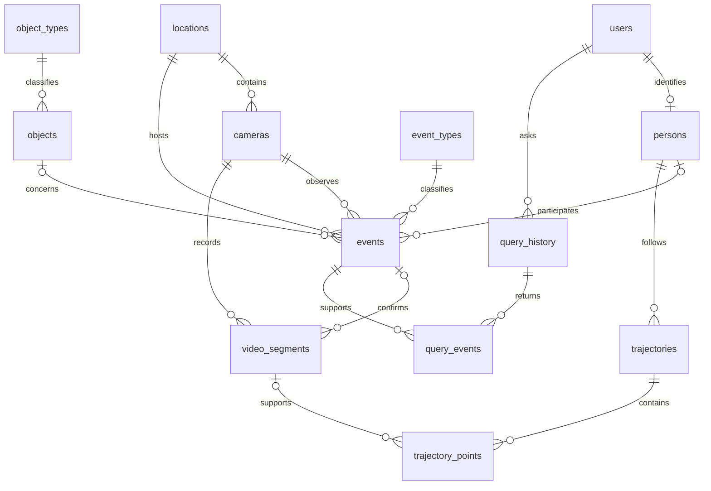

# Схема данных

Источник — актуальная ER-диаграмма Unidraw системы поиска вещей. SQL-схема хранит события видеонаблюдения отдельно от вопросов пользователя. `Query_history` содержит историю вопросов и ответов; `query_events` связывает её с найденными событиями.

## Сущности

| ER-сущность | SQL-таблица | Содержание |
|---|---|---|
| User | `users` | Аккаунт приложения: username, имя, место для password_hash, дата создания |
| Person | `persons` | Человек, обнаруженный камерой: необязательная связь с аккаунтом, признаки, первое/последнее обнаружение |
| Object | `objects` | Конкретный предмет: тип, название, статус, путь к изображению, первое/последнее обнаружение |
| Object_Type | `object_types` | Категория предмета и описание |
| Event | `events` | Зафиксированное событие: тип, камера, место, человек/предмет, время, уверенность, описание |
| Event_Type | `event_types` | Тип события и описание |
| Location | `locations` | Место: имя, тип, описание, координаты |
| Camera | `cameras` | Камера: место, имя, URL потока, разрешение, FPS, статус |
| Video_segment | `video_segments` | Камера, необязательное событие, начало/конец фрагмента, ссылка на файл и превью |
| Trajectory | `trajectories` | Траектория человека: начало/конец, места, статус и направление |
| Trajectory_point | `trajectory_points` | Точка траектории: время, x/y, необязательная z и ссылка на видео |
| Query_history, ранее Event_history | `query_history` | Пользовательский вопрос, ответ, время и статус обработки |
| Связь запросов с событиями | `query_events` | Пары query_id/event_id; первичный ключ не допускает повторную пару |

Техническая таблица `goose_db_version` хранит версии миграций.

## Связи

- Место содержит несколько камер; камера относится к одному месту.
- У аккаунта может быть один профиль обнаруженного человека; у обнаруженного человека аккаунта может не быть. `persons.user_id` nullable и unique.
- Тип предмета объединяет несколько конкретных предметов.
- Запись события относится к одному типу, одной камере и одному месту. Человек и предмет могут быть неизвестны, поэтому их ссылки nullable.
- Для записи события место должно совпадать с местом указанной камеры: это контролирует составной внешний ключ.
- Событие может иметь несколько видеофрагментов. Фрагмент относится к одной камере и может существовать до привязки к событию. При привязке камера фрагмента должна совпадать с камерой события.
- У человека может быть несколько траекторий, у траектории — несколько точек.
- Пользователь имеет несколько запросов. Запрос может ссылаться на несколько событий, событие может использоваться в нескольких ответах.

На исходной ранней диаграмме некоторые кратности и атрибуты допускают разные трактовки. В SQL закреплены перечисленные выше правила: одна запись события содержит не более одного человека и одного предмета, а видеофрагменты относятся к событию через `event_id`. Эти правила также учитываются при обработке операций API.

## Типы и ограничения

- Первичные ключи — BIGINT IDENTITY, выдаются PostgreSQL. Внешние ключи имеют тот же тип.
- Время — TIMESTAMPTZ. Часовой пояс отображения выбирает клиент; база хранит момент времени.
- Координаты места и признаки человека — JSONB-объекты. Здесь пока нет согласованной системы координат или модели признаков. Векторы фиксированной размерности не выдумываются.
- Уверенность события — от 0 до 1. FPS положительный; x/y/z не допускают NaN и бесконечности.
- Для объекта и человека первое обнаружение не может быть позже последнего.
- Видеофрагмент имеет положительную длительность. `duration_seconds` вычисляется PostgreSQL из начала/конца, чтобы не хранить противоречивые значения.
- Конец траектории не может быть раньше начала. Проверка времени отдельной точки относительно всей траектории остаётся для сервисной логики второго PR.
- Названия и текст запроса не могут быть пустыми. Обязательные ссылки проверяются внешними ключами.
- Связанные записи удаляются через RESTRICT. Автоматического удаления истории и видео при удалении камеры/пользователя нет. При изменении места камеры существующие ссылки событий также потребуют явного решения; API возвращает конфликт 409.
- `password_hash` необязательный: авторизация в первом этапе не реализуется. Поле предназначено для хеша, открытые пароли не хранятся.
- URL камеры и ссылки на файлы — только значения в БД. Этот PR не загружает файлы и не подключается к указанным URL.

## Предварительные состояния

| Поле | Допустимые значения |
|---|---|
| Камера | offline, online, disabled |
| Предмет | unknown, visible, lost, found |
| Траектория | active, completed, lost |
| Запрос | pending, processing, completed, failed |

Состояния закреплены CHECK-ограничениями. Справочники типов событий и предметов создаются пустыми; их значения добавляются через API `/event_type` и `/object_type`.

## Инициализация и обновления

`scripts/init-db.sql` устанавливает vector только при первом создании пустого volume. Изменение этого файла не обновляет готовую базу.

Goose применяет встроенные миграции по порядку и хранит результат в БД. Первая миграция также включает vector, поэтому база с существующим volume не зависит от повторного выполнения init-скрипта. Вторая создаёт прикладные таблицы и индексы. Повторный запуск не удаляет данные; применённые миграции не редактируются, изменения добавляются новыми файлами.

Down-миграция второй версии удаляет прикладные таблицы; она предназначена для проверки/разработки, а не для отката ценных данных. HTTP API и обычный запуск не вызывают Down. Первая Down оставляет общее расширение vector, чтобы не затронуть другие схемы.

## Проверки

Интеграционные тесты проверяют создание всех 13 таблиц, работу vector, повтор миграций с сохранением записи, Down/Up в изолированной тестовой схеме, внешние ключи, согласованность камер и мест, ограничения дат/уверенности и связь запросов с событиями многие-ко-многим.

Скрипт `verify` отдельно проверяет сохранение строки в настоящем volume после перезапуска контейнера PostgreSQL.
